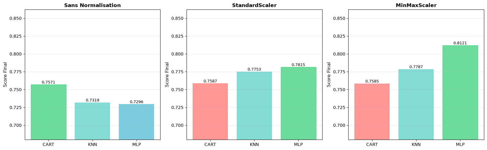
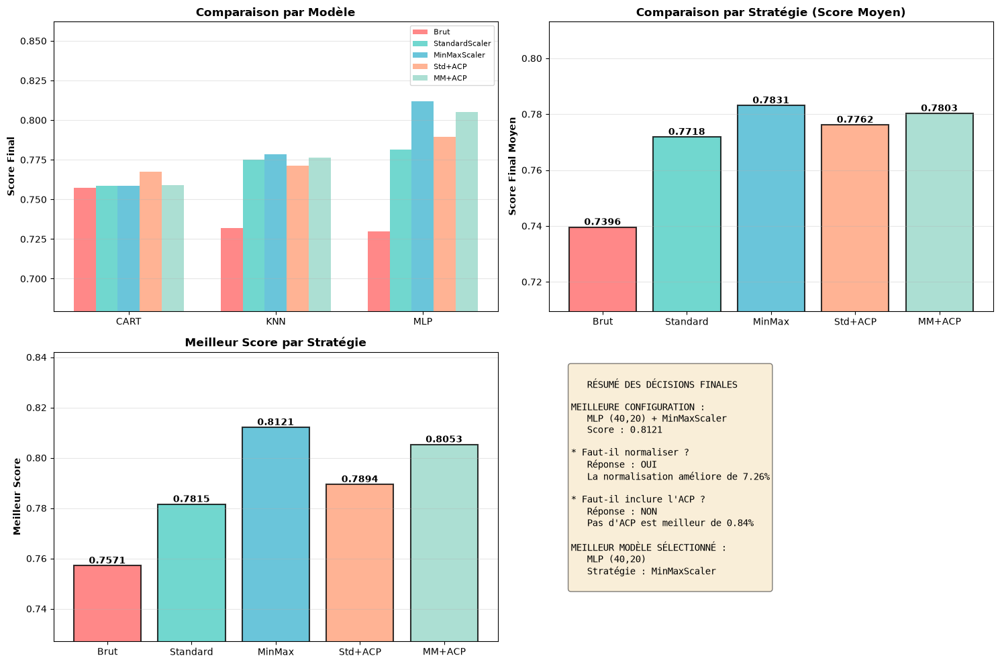
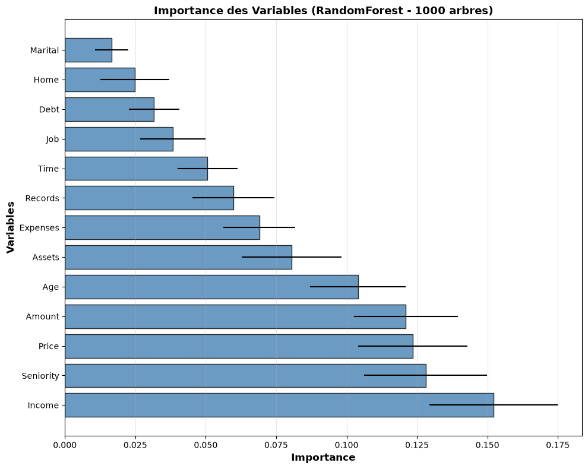
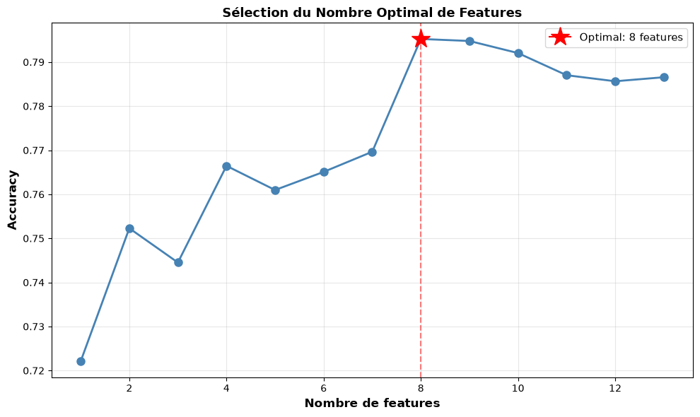
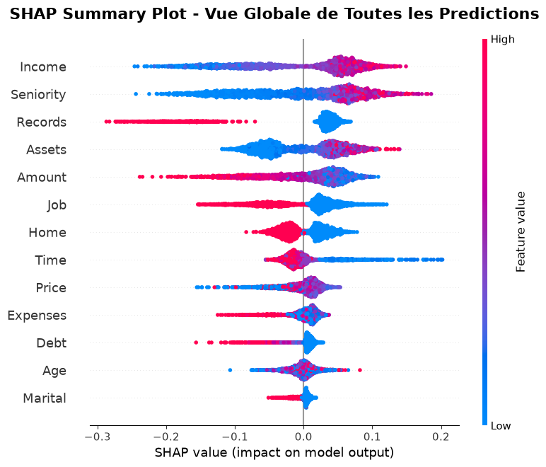
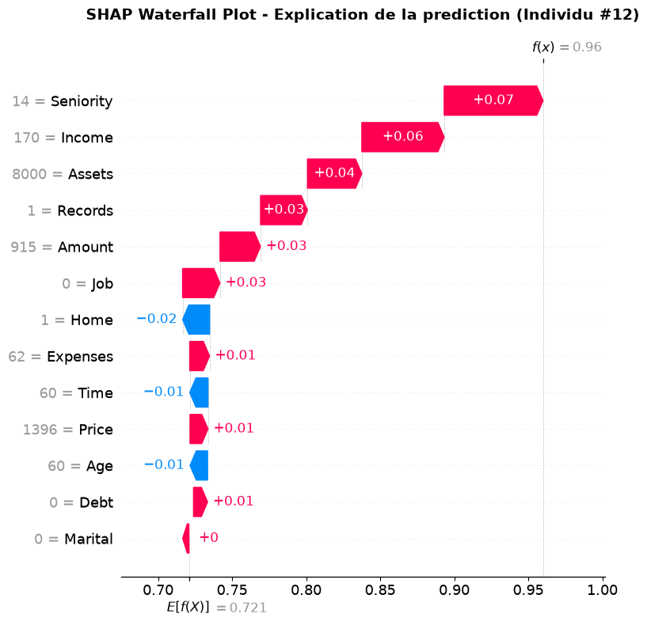
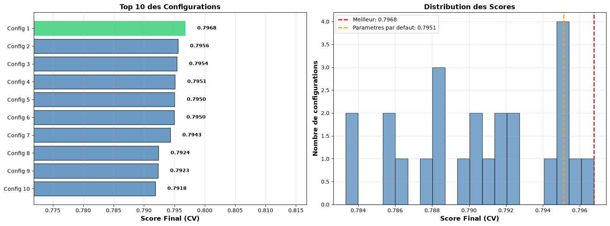
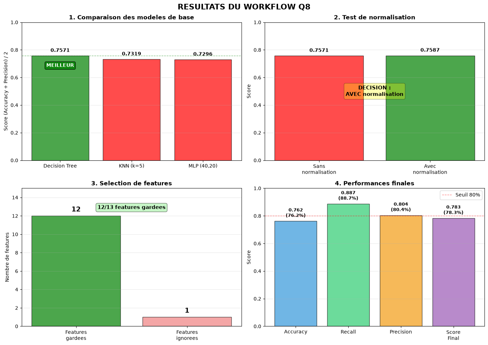
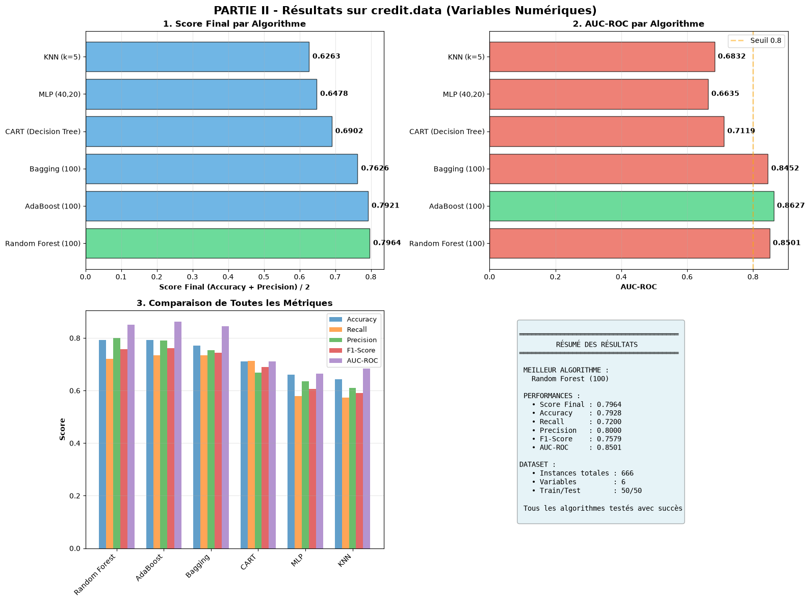
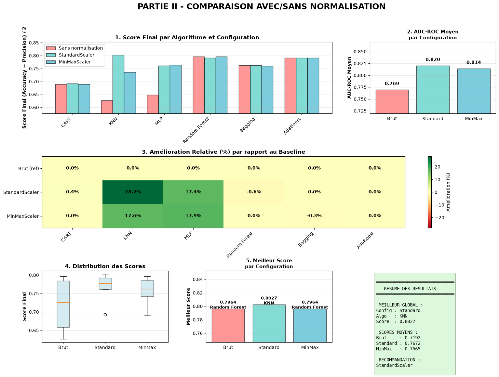

# Credit Scoring – Apprentissage automatique

**Auteurs :** ABBAS Yasmina · GHERZOULI Maria Sara · KESRAOUI Sarah

Projet réalisé en groupe dans le cadre d'un TP d'apprentissage automatique.

## En bref

- **Objectif :** prédire si un crédit peut être accordé, en limitant les crédits accordés à
  des clients qui ne rembourseront pas.
- **Démarche :** comparaison de 8 algorithmes, normalisation, ACP, sélection de variables,
  optimisation des hyperparamètres, pipelines scikit-learn, validation croisée,
  explicabilité avec SHAP et mise à disposition du modèle par une API.
- **Résultats :**
  - meilleur pipeline sur le jeu de test : score final de **0.8095** (precision 84,7 %),
    avec 61 % des clients défaillants détectés ;
  - en validation croisée 10 plis, AdaBoost obtient le meilleur score (**0.81**) ;
  - sur le second jeu de données, l'ajout des variables catégorielles fait passer le meilleur
    score de 0.80 à **0.88**.
- **Technologies :** Python, pandas, NumPy, scikit-learn, XGBoost, SHAP, Matplotlib,
  FastAPI, Uvicorn, Jupyter.

Le projet comporte deux parties :

- **Partie I** – `credit_scoring.csv` (4 375 clients, 13 variables numériques) : comparaison de
  modèles, normalisation, ACP, sélection de variables, optimisation des hyperparamètres,
  pipeline, orchestration automatique, API FastAPI et validation croisée.
- **Partie II** – `credit.data` (688 clients, 15 variables numériques et catégorielles) :
  valeurs manquantes, normalisation et encodage one-hot.

Tous les chiffres et graphiques ci-dessous proviennent de l'exécution du notebook
`notebooks/TpApprentissageFinale.ipynb`.

## Données

Les deux jeux de données ont été fournis avec le TP :

- `credit_scoring.csv` : 4 375 clients décrits par 13 variables numériques (ancienneté
  professionnelle, revenus, patrimoine, dettes, montant demandé, prix du bien…) et la cible
  `Status` (1 = crédit accordé / bon payeur, 0 = défaillant) ;
- `credit.data` : 688 demandes de crédit décrites par 15 variables anonymisées
  (6 numériques, 9 catégorielles). C'est une version du jeu public *Credit Approval* de l'UCI.

## Structure du projet

```
.
├── data/
│   ├── credit_scoring.csv            # Partie I (séparateur « ; »)
│   └── credit.data                   # Partie II (tabulations, « ? » = valeur manquante)
├── docs/
│   ├── API.png                       # Capture d'écran des tests de l'API (Colab)
│   └── images/                       # Graphiques du notebook utilisés dans ce README
├── models/                           # Pipelines générés par le notebook (pickle)
│   ├── credit_scoring_pipeline.pkl   # Q7  : pipeline construit pas à pas
│   ├── final_pipeline_auto.pkl       # Q8  : pipeline de l'orchestration (utilisé par l'API)
│   └── final_pipeline_cv.pkl         # Q10 : meilleur modèle en validation croisée
├── notebooks/
│   └── TpApprentissageFinale.ipynb   # Notebook principal (Parties I et II)
├── src/
│   ├── utils.py                      # Q8 : orchestration + critère de score commun
│   └── api.py                        # Q9 : API FastAPI
├── requirements.txt
└── README.md
```

## Installation et exécution

### Installation

Python 3.10 ou plus récent :

```bash
python -m venv .venv
.venv\Scripts\activate          # Windows
source .venv/bin/activate       # macOS / Linux
pip install -r requirements.txt
```

### Notebook

```bash
jupyter notebook notebooks/TpApprentissageFinale.ipynb
```

Le notebook peut aussi être ouvert dans VS Code. Exécuter toutes les cellules dans l'ordre
(environ 10 minutes) : la première cellule trouve la racine du projet et ajoute `src/` au
chemin Python. Les pipelines de `models/` sont régénérés pendant l'exécution (Q7, Q8 et Q10).

**Sur Google Colab :** copier le dossier du projet dans Google Drive, ouvrir le notebook puis,
si besoin, adapter `PROJECT_DIR` dans la première cellule
(par défaut `/content/drive/MyDrive/ABBAS_Yasmina_GHERZOULI_Maria_Sara_KESRAOUI_Sarah`).

### API

Le fichier `models/final_pipeline_auto.pkl` doit exister (il est créé par la Q8).
Depuis la racine du projet :

```bash
python -m uvicorn api:app --app-dir src --reload
```

Documentation interactive : <http://127.0.0.1:8000/docs>

| Méthode | Route | Rôle |
|---|---|---|
| GET | `/` | Présentation de l'API |
| GET | `/health/` | État de l'API et étapes du pipeline |
| POST | `/predict/` | Prédiction pour un client |
| POST | `/predict_batch/` | Prédiction pour une liste de clients |

Exemple avec PowerShell :

```powershell
$client = @{ seniority=9; home=1; time=60; age=30; marital=2; records=0; job=3
             expenses=73; income=129; assets=0; debt=0; amount=800; price=846 }
Invoke-RestMethod -Method Post -Uri http://127.0.0.1:8000/predict/ `
    -ContentType 'application/json' -Body ($client | ConvertTo-Json)
```

Exemple avec curl :

```bash
curl -X POST http://127.0.0.1:8000/predict/ -H "Content-Type: application/json" \
  -d '{"seniority": 9, "home": 1, "time": 60, "age": 30, "marital": 2, "records": 0, "job": 3,
       "expenses": 73, "income": 129, "assets": 0, "debt": 0, "amount": 800, "price": 846}'
```

Pour servir un autre modèle, définir la variable d'environnement `CREDIT_MODEL_PATH`
(par exemple vers `models/credit_scoring_pipeline.pkl`).

## Critère de performance

La classe positive (`Status = 1`) correspond à un crédit **accordé / bon payeur**, la classe 0
à un client **défaillant**.

| Erreur | Signification | Conséquence pour la banque |
|---|---|---|
| Faux positif (FP) | crédit accordé à un défaillant | **perte d'argent (risque)** |
| Faux négatif (FN) | crédit refusé à un bon client | manque à gagner |

- **Precision** = TP / (TP + FP) : parmi les crédits accordés, part de bons payeurs.
- **Recall** = TP / (TP + FN) : part des bons clients qui obtiennent leur crédit.
- **Spécificité** = TN / (TN + FP) : part des défaillants détectés (refusés).

Un défaillant à qui l'on accorde un crédit coûte plus cher qu'un bon client refusé :
on retient la precision.

**Score final = (Accuracy + Precision) / 2**

Ce critère est défini une seule fois (`CRITERE`, au début de la Q2) et réutilisé partout :
Q2 à Q10, `src/utils.py` et Partie II. Pour comparer avec le recall, passer `CRITERE` à
`'recall'` puis ré-exécuter tout le notebook.

---

## Partie I – `credit_scoring.csv`

### Q1. Chargement et préparation des données

- 4 375 clients, 13 variables numériques, cible `Status`.
- 3 159 crédits accordés (72,2 %) contre 1 216 défaillants (27,8 %) : jeu déséquilibré
  (2,6 positifs pour 1 négatif).
- Découpage 50/50 stratifié (`random_state=1`) : 2 187 individus en apprentissage,
  2 188 en test.

### Q2. Apprentissage et évaluation de 3 modèles

Résultats sur le jeu de test, sans prétraitement :

| Modèle | Accuracy | Recall | Precision | Spécificité | AUC | Score final |
|---|---|---|---|---|---|---|
| CART (arbre de décision) | 0.7121 | 0.7981 | 0.8022 | 0.4885 | 0.6433 | **0.7571** |
| KNN (k = 5) | 0.7034 | 0.8601 | 0.7605 | 0.2961 | 0.6478 | 0.7319 |
| MLP (40, 20) | 0.7239 | 0.9652 | 0.7353 | 0.0970 | 0.6791 | 0.7296 |

Sur données brutes, le MLP accorde presque tous les crédits : son recall est de 96,5 %, mais
il ne refuse que 9,7 % des défaillants. Ce comportement explique le choix de la precision
comme critère.

### Q3. Normalisation

Les 3 modèles sont ré-entraînés avec `StandardScaler` puis `MinMaxScaler`
(scalers appris sur le jeu d'apprentissage uniquement).



La normalisation améliore nettement les modèles sensibles à l'échelle des variables :
KNN passe de 0.7319 à 0.7787 et le MLP de 0.7296 à **0.8121** avec `MinMaxScaler`.
L'arbre CART n'est presque pas affecté.

### Q4. ACP

Les 3 premières composantes principales (apprises sur le jeu d'apprentissage normalisé) sont
**ajoutées** aux 13 variables. Les 5 préparations sont comparées pour les 3 modèles :



- **Faut-il normaliser ?** Oui : +7,26 % par rapport au meilleur modèle sans normalisation.
- **Faut-il ajouter l'ACP ?** Non : le meilleur score avec ACP (0.8053) est inférieur au
  meilleur score sans ACP (0.8121).
- **Configuration retenue pour la suite :** MLP (40, 20) + `MinMaxScaler`, score 0.8121.

### Q5. Sélection de variables

L'importance des variables est mesurée avec une RandomForest de 1 000 arbres, puis le MLP
normalisé est entraîné avec les *n* variables les plus importantes (*n* = 1 à 13).

| Importance des variables | Accuracy selon le nombre de variables |
|---|---|
|  |  |

L'accuracy est maximale (0.7952) avec les **8 variables** les plus importantes :
Income, Seniority, Price, Amount, Age, Assets, Expenses et Records.

**Explication avec SHAP** (sur une RandomForest de 100 arbres) :

| Vue globale | Explication d'une prédiction |
|---|---|
|  |  |

- Les variables les plus influentes sont Income (0.0755), Seniority (0.0706) et Records
  (0.0613).
- Un revenu ou une ancienneté élevés poussent vers l'acceptation. Des antécédents d'impayés
  (`Records` élevé) poussent fortement vers le refus.
- Exemple à droite : partant de la probabilité moyenne d'accord (0,72), l'ancienneté
  (14 ans), le revenu et le patrimoine de ce client portent la prédiction à 0,96.

### Q6. Optimisation des hyperparamètres

GridSearchCV sur le MLP : 24 combinaisons (taille des couches, `alpha`, `learning_rate_init`),
validation croisée 5 plis, sur les données normalisées et les 8 variables retenues.



- Meilleurs paramètres : `hidden_layer_sizes=(40, 20)`, `alpha=0.0001`,
  `learning_rate_init=0.01`.
- Le gain en validation croisée est faible : 0.7968, contre 0.7951 avec les paramètres
  par défaut.
- Score sur le jeu de test : **0.8095**.

### Q7. Pipeline complet

Le pipeline regroupe toutes les décisions précédentes et prend en entrée les **13 variables
brutes** :

```
MinMaxScaler  →  sélection des 8 variables  →  MLP (40, 20), alpha = 0.0001, lr = 0.01
```

| Accuracy | Precision | Recall | Spécificité | AUC | Score final |
|---|---|---|---|---|---|
| 0.7715 | 0.8475 | 0.8335 | 0.6102 | 0.8130 | **0.8095** |

Le pipeline reproduit exactement le modèle optimisé de la Q6. Il refuse 61 % des
défaillants, contre 9,7 % pour le MLP de la Q2. Il est sauvegardé dans
`models/credit_scoring_pipeline.pkl`.

### Q8. Orchestration automatique (`src/utils.py`)

La fonction `pipeline_generation_train_test_split()` automatise les étapes Q2 → Q7 avec le
même critère, puis sauvegarde le pipeline dans `models/final_pipeline_auto.pkl` :



1. comparaison des 3 modèles sur données brutes : l'arbre de décision est le meilleur (0.7571) ;
2. test de la normalisation : conservée (0.7587) ;
3. sélection de 12 variables sur 13 ;
4. GridSearch : `max_depth=5`, `min_samples_split=2` ;
5. score sur le test : **0.7828** (precision 0.8038, recall 0.8867).

La fonction choisit le modèle **avant** de tester la normalisation : elle favorise donc l'arbre,
insensible à l'échelle, alors que l'étude détaillée (Q3–Q4) retient le MLP normalisé.

### Q9. API FastAPI (`src/api.py`)

L'API charge `models/final_pipeline_auto.pkl`. Tests exécutés depuis le notebook :

```
TEST 1: Health Check
Status: 200
{
  "status": "healthy",
  "pipeline_file": "final_pipeline_auto.pkl",
  "pipeline_type": "<class 'sklearn.pipeline.Pipeline'>",
  "pipeline_steps": ["scaler", "feature_selection", "classifier"]
}

TEST 2: Prédiction Individuelle
Client: Âge=30.0, Revenu=129.0, Dette=0.0
  • CRÉDIT ACCORDÉ
  • Probabilité d'accord: 98.13%

TEST 3: Prédiction Batch (3 individus)
  • Total: 3   • Accordés: 3   • Taux: 100.0%
    Client 1: CRÉDIT ACCORDÉ (vrai=1) True
    Client 2: CRÉDIT ACCORDÉ (vrai=0) False
    Client 3: CRÉDIT ACCORDÉ (vrai=1) True
```

Les données invalides et les listes vides sont refusées avec un code 422.

### Q10. Validation croisée et comparaison de 8 algorithmes

Validation croisée 10 plis sur les 4 375 clients. La normalisation et l'ACP sont placées dans
un pipeline : elles sont ré-apprises sur chaque pli d'apprentissage. Score final moyen :

| Algorithme | Brut | StandardScaler | StandardScaler + ACP |
|---|---|---|---|
| AdaBoost (200) | **0.8100** | **0.8100** | **0.8086** |
| Bagging (200) | 0.8036 | 0.8038 | 0.7994 |
| Random Forest (200) | 0.8020 | 0.8026 | 0.7992 |
| XGBoost (200) | 0.7968 | 0.7968 | 0.8061 |
| MLP (20, 10) | 0.7454 | 0.8054 | 0.8053 |
| KNN (k = 5) | 0.7411 | 0.7885 | 0.7906 |
| CART | 0.7673 | 0.7670 | 0.7612 |
| Decision Stump | 0.7310 | 0.7310 | 0.7310 |

Les méthodes d'ensemble dominent, et AdaBoost est le meilleur dans les trois configurations.
Le pipeline final est un AdaBoost optimisé (200 arbres, `learning_rate=0.5`) sur données
brutes ; la validation croisée a écarté la sélection de variables. Score en validation croisée
5 plis : **0.8084**. Il est sauvegardé dans `models/final_pipeline_cv.pkl`.

---

## Partie II – `credit.data`

### Q1. Variables numériques uniquement

688 clients, 15 variables (6 numériques, 9 catégorielles) et des valeurs manquantes notées
« ? ». On garde les 6 variables numériques et on supprime les 22 individus incomplets :
666 clients restent (299 crédits accordés, 367 refusés).



Score final selon la normalisation :

| Algorithme | Brut | StandardScaler | MinMaxScaler |
|---|---|---|---|
| CART | 0.6902 | 0.6928 | 0.6902 |
| KNN (k = 5) | 0.6263 | **0.8027** | 0.7364 |
| MLP (40, 20) | 0.6478 | 0.7609 | 0.7638 |
| Random Forest (100) | 0.7964 | 0.7920 | 0.7964 |
| Bagging (100) | 0.7626 | 0.7626 | 0.7602 |
| AdaBoost (100) | 0.7921 | 0.7921 | 0.7921 |
| **Moyenne** | 0.7192 | **0.7672** | 0.7565 |



`StandardScaler` donne le meilleur score moyen. Comme en Partie I, il profite surtout à KNN
(+28 %) et au MLP (+17 %) ; les méthodes à base d'arbres ne changent pas.

### Q2. Toutes les variables (numériques + catégorielles)

Les 15 variables sont utilisées. Les variables numériques sont imputées par la moyenne puis
normalisées. Les variables catégorielles reçoivent une modalité `MISSING`, puis un encodage
one-hot. On obtient 46 variables, avec un prétraitement appris sur le jeu d'apprentissage
uniquement.

| Algorithme | 6 variables (StandardScaler) | 15 variables | Écart |
|---|---|---|---|
| CART | 0.6928 | 0.8442 | +21,9 % |
| KNN (k = 5) | 0.8027 | 0.8518 | +6,1 % |
| MLP (40, 20) | 0.7609 | 0.8083 | +6,2 % |
| Random Forest (100) | 0.7920 | **0.8785** | +10,9 % |
| Bagging (100) | 0.7626 | 0.8714 | +14,3 % |
| AdaBoost (100) | 0.7921 | 0.8568 | +8,2 % |

Les variables catégorielles apportent une information importante : le meilleur score passe
de 0.8027 à **0.8785** (Random Forest), soit +9,4 %.

---

## Modèles sauvegardés

| Fichier | Question | Contenu | Score final |
|---|---|---|---|
| `credit_scoring_pipeline.pkl` | Q7 | MinMaxScaler → 8 variables → MLP (40, 20) | 0.8095 (test) |
| `final_pipeline_auto.pkl` | Q8 | StandardScaler → 12 variables → arbre (`max_depth=5`), utilisé par l'API | 0.7828 (test) |
| `final_pipeline_cv.pkl` | Q10 | AdaBoost (200 arbres, `learning_rate=0.5`) | 0.8084 (CV 5 plis) |

Les trois pipelines prennent en entrée les 13 variables brutes de `credit_scoring.csv`
(sans `Status`), dans l'ordre du fichier.

## Limites et pistes d'amélioration

- Comme le demande le TP, le choix du modèle, de la normalisation et du nombre de variables
  (Q2 à Q5) se fait sur le jeu de test : les scores de test de la Partie I sont donc
  légèrement optimistes. La validation croisée de la Q10 donne une estimation plus fiable.
- Le déséquilibre des classes (72 % / 28 %) n'est pas traité. Pondérer les classes ou ajuster
  le seuil de décision permettrait de choisir explicitement le compromis entre risque et
  manque à gagner.
- Le score final (Accuracy + Precision) / 2 est un compromis simple ; une approche métier
  utiliserait le coût réel de chaque type d'erreur.
- L'explication SHAP porte sur une RandomForest, pas sur le MLP retenu.

## Remarques

- Les fichiers `.pkl` dépendent de la version de scikit-learn qui les a créés
  (scikit-learn 1.9.1 pour ceux fournis). Avec une autre version, ré-exécuter le notebook
  pour les régénérer.
- Sous Windows, si `pip install` échoue avec une erreur de chemin trop long, placer le projet
  dans un dossier au chemin plus court (par exemple `C:\TP\credit-scoring`).
